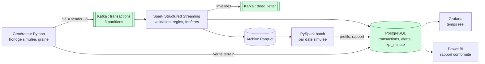

# SenPay – détection d'anomalies en temps réel sur des transactions mobile money

> **EN —** Streaming pipeline for a fictional Senegalese mobile money fintech: synthetic
> transactions → Kafka → Spark Structured Streaming → explainable fraud rules, per-minute KPIs and
> alerts in PostgreSQL, live Grafana dashboard; a daily PySpark batch on the Parquet archive feeds a
> compliance report in Power BI. **Work in progress: phase 1 (infrastructure) of 9.**

> ⚠️ **Données 100 % fictives.** SenPay est une fintech **fictive** ; aucune marque réelle n'est
> utilisée. Les identifiants (`U-000123`, `M-0042`, `A-0137`) ne ressemblent pas à des numéros de
> téléphone. Les règles, seuils et plafonds sont illustratifs : ce n'est ni un vrai système
> antifraude, ni une application de plafonds réglementaires.

## Objectif

Le mobile money est un moyen de paiement central au Sénégal. Une fraude repérée le lendemain, dans
un rapport batch, est en général déjà perdue. Le projet construit un pipeline de bout en bout qui :

- ingère un flux de transactions simulées en continu, avec l'ordre garanti par client ;
- détecte des comportements suspects avec des règles explicables : **rafale** de transferts,
  **montant anormal** par rapport à l'habitude du client, **gros montant de nuit** ;
- calcule des indicateurs par minute, par région et par canal, affichés en direct ;
- traite chaque jour l'archive de la veille en batch (agrégats, profils recalculés, rapport) ;
- **mesure** la détection (précision, rappel, latence) contre une vérité terrain que le générateur
  consigne à part, hors du message Kafka.

## Architecture cible



En vert : ce qui est en place à la fin de la phase 1. Deux profils Docker Compose, jamais lancés
ensemble : `streaming` (Kafka, PostgreSQL, puis générateur, Spark, Grafana) et `batch`
(PostgreSQL, puis Airflow et Spark batch).

## Avancement

| Phase | Contenu | État |
|---|---|:---:|
| 0 | Cadrage : schéma de l'événement, règles, mesure de la détection | ✅ |
| 1 | Socle : Kafka KRaft, PostgreSQL, topics, tables, versions figées, mémoire mesurée | ✅ |
| 2 | Générateur : horloge simulée, anomalies injectées, vérité terrain, retards, messages invalides | ✅ |
| 3 | Premier consommateur Spark : lecture, validation, écriture en base | — |
| 4 | Règles sans état : montant anormal, gros montant de nuit | — |
| 5 | Fenêtres : rafale, indicateurs par minute, watermark | — |
| 6 | Robustesse : checkpoints, dead letter queue, archive Parquet | — |
| 7 | Batch PySpark quotidien et DAG Airflow | — |
| 8 | Grafana et rapport Power BI | — |
| 9 | CI, documentation, vidéo | — |

## Socle en place (phase 1)

| Élément | Détail |
|---|---|
| Kafka 4.3.2 | KRaft, un nœud (broker et contrôleur), tas de 512 Mo, création automatique des topics désactivée ; listeners `kafka:29092` (conteneurs) et `127.0.0.1:9092` (hôte) |
| Topics | `transactions` : 3 partitions, rétention 7 jours ; `dead_letter` : 1 partition, 7 jours ; créés par le conteneur ponctuel `kafka-init` (rejouable) |
| PostgreSQL 17.12 | port hôte **5434** (5432 = PostgreSQL local, 5433 = projet 1), volume nommé ; les 8 tables du projet créées par [`sql/init.sql`](sql/init.sql), avec les contraintes du schéma de l'événement |
| Contrôle | `make check` : lint, types (mypy strict), tests, puis [`scripts/check_infra.py`](scripts/check_infra.py) (ports publiés, topics, partitions, rétention, tables) |
| Sécurité locale | ports publiés sur `127.0.0.1` seulement ; variables préfixées `SENPAY_`, et `make` refuse de démarrer si une variable `SENPAY_*` ou `POSTGRES_*` est exportée dans le shell (elle écraserait `.env`) |
| Versions | figées dans [docs/versions.md](docs/versions.md), dont Spark 4.2.1, son connecteur Kafka et le pilote JDBC |
| Choix | justifiés dans [docs/choix-techniques.md](docs/choix-techniques.md) |

## Générateur (phase 2)

Le générateur produit un flux de transactions **fictives**, reproductible, avec des anomalies
injectées dont la liste (la vérité terrain) est écrite à part en base, jamais dans le message
Kafka. Il tourne sur l'hôte et envoie vers `127.0.0.1:9092`.

```bash
make generate ARGS="--seed 42 --start 2026-11-23T00:00:00Z --duration 1d --speed max --init-profiles"
```

| Option | Rôle |
|---|---|
| `--seed` | graine : même graine + mêmes paramètres = mêmes transactions |
| `--start`, `--duration` | plage simulée (`30min`, `2h`, `1d`, `30d`) ; refusée si elle finit dans le futur réel, ou si elle commence avant la fin du dernier run (`make reset` pour rejouer) |
| `--speed` | facteur de vitesse (`60` : 1 jour simulé en 24 min ; 10 min simulées durent 10 s) ou `max` (sans attente) |
| `--init-profiles` | écrit les 10 000 profils d'amorçage (`user_profiles`, source `GENERATEUR`) |
| `--dry-run --out run.jsonl` | sans Kafka ni base : écrit les émissions dans un fichier ; deux fichiers de même graine ont le même sha256 |

Paramètres (volumes, lois, taux) : [`config/generator.toml`](config/generator.toml), valeurs
illustratives. Les seuils des règles de détection n'y sont pas : générateur et règles sont
indépendants.

**Contenu d'un run** (graine 42, journée simulée du 23/11/2026, `--speed max`, 25/11/2026) :

| Mesure | Valeur |
|---|---|
| Messages envoyés (`nb_sent`) | **30 530** = somme des offsets de fin du topic (9 627 + 10 323 + 10 580) |
| Épisodes injectés | rafale 12 (95 transactions), montant anormal 45, nuit + gros montant 26, cash-out rapide 13 (26), changement de région 22 (44) ; chaque type → sa règle attendue (R1 à R5) |
| Messages en retard | 1 571 (5,15 %) de 10 s à 5 min ; 56 (0,18 %) de 15 à 30 min |
| Messages invalides | 135 (0,44 %), 8 motifs : JSON illisible, champ manquant, `schema_version` = 2, type inconnu, montant hors bornes, canal incohérent, destinataire = émetteur, `event_time` dans le futur |
| Profils d'amorçage | 10 000 |
| Durée | 1,7 s (≈ 18 000 msg/s, sans attente : mesure du générateur sur ce poste, pas du pipeline) |

- R4 et R5 sont **injectés mais pas détectés** au MVP : le rappel global restera sous 100 %.
- Une transaction d'épisode n'est jamais invalide ni très en retard : une non-détection doit
  venir de la règle, pas du générateur.
- Du trafic normal est généré **près des seuils** (presque-rafales de 5 transferts, gros montants
  de jour, montants de nuit juste sous 500 000, sorties à 6–9 × la médiane) pour que des faux
  positifs restent possibles.

Un message réel du topic (clé = `sender_id`, valeur = JSON v1) :

```bash
docker compose --env-file .env --profile streaming exec kafka \
  /opt/kafka/bin/kafka-console-consumer.sh --bootstrap-server localhost:29092 \
  --topic transactions --partition 0 --offset 0 --max-messages 1 \
  --formatter-property print.key=true --formatter-property key.separator=" | "
```

```
U-000112 | {"schema_version":1,"transaction_id":"5e1439b7-193b-4a80-b5e5-c4c1e508166b","event_time":"2026-11-23T00:01:20.814Z","sender_id":"U-000112","receiver_id":"U-005719","type":"TRANSFER","amount_xof":1344,"region":"Diourbel","channel":"APP","agent_id":null}
```

**Limites du générateur**

- Données **100 % fictives** ; lois et taux illustratifs, pas des statistiques d'opérateur.
- **Circularité** : le générateur et les règles sont conçus par la même personne ; les mesures
  de détection montreront la cohérence du système, pas son efficacité sur de vraies fraudes.
- Profils d'amorçage calculés depuis les paramètres du générateur (médiane exacte de la loi de
  chaque client) : ils jouent l'historique d'un ancien système, jusqu'au premier batch.
- Pas de messages en double (producteur idempotent) ; pas de dédoublonnage à tester au MVP.
- Le motif « `event_time` dans le futur » dépend de l'heure réelle d'envoi : le `--dry-run`
  enregistre le décalage, pas la valeur.

## Lancer le projet

Prérequis : Docker, [uv](https://docs.astral.sh/uv/), make (sous Windows : WSL2 et Docker Desktop).
Les ports 5434 (PostgreSQL) et 9092 (Kafka) doivent être libres.

```bash
git clone https://github.com/NdeyePendaSarr/mobile-money-fraud-streaming.git
cd mobile-money-fraud-streaming
cp .env.example .env   # puis choisis un mot de passe dans .env
make install           # environnement Python 3.12
make up                # profil streaming : Kafka, création des topics, PostgreSQL
make check             # lint, types, tests, topics et tables
make generate ARGS="--seed 42 --start 2026-11-23T00:00:00Z --duration 1d --speed max --init-profiles"
make test-integration  # run réel d'une heure simulée (écrit en base)
make topics            # liste et décrit les topics
make stats             # mémoire des conteneurs
make down              # arrêt, données conservées
make reset             # arrêt et suppression des topics, des tables et des checkpoints
```

## Mémoire mesurée

Profil `streaming` (Kafka + PostgreSQL), `docker stats`, 25/11/2026 :

| Conteneur | Repos | Charge (régime stable) | Charge (pic) |
|---|---|---|---|
| `kafka` (tas 512 Mo) | 300 MiB | ≈ 557 MiB | 597 MiB (737 MiB en `memory.peak`, cache de pages compris) |
| `postgres` | 36 MiB | 35 à 38 MiB | 38 MiB |
| **Total** | **≈ 336 MiB** | **≈ 595 MiB** | **≈ 635 MiB** |

Charge : 100 000 messages de 300 octets envoyés à **1 000 msg/s, débit imposé** au producteur de
test (`--throughput 1000`) et non capacité mesurée du broker ; 1 007,7 msg/s obtenus, latence
d'envoi p50 5 ms, p95 12 ms. Kafka tient dans son budget : pas besoin du plan B Redpanda.
Protocole et détail : [docs/memoire.md](docs/memoire.md).

## Licence

MIT — voir [LICENSE](LICENSE).

## Autrice

**Ndeye Penda SARR** — Master 2 Business Intelligence (UCAD) · Data Engineering (Orange Digital Center)
